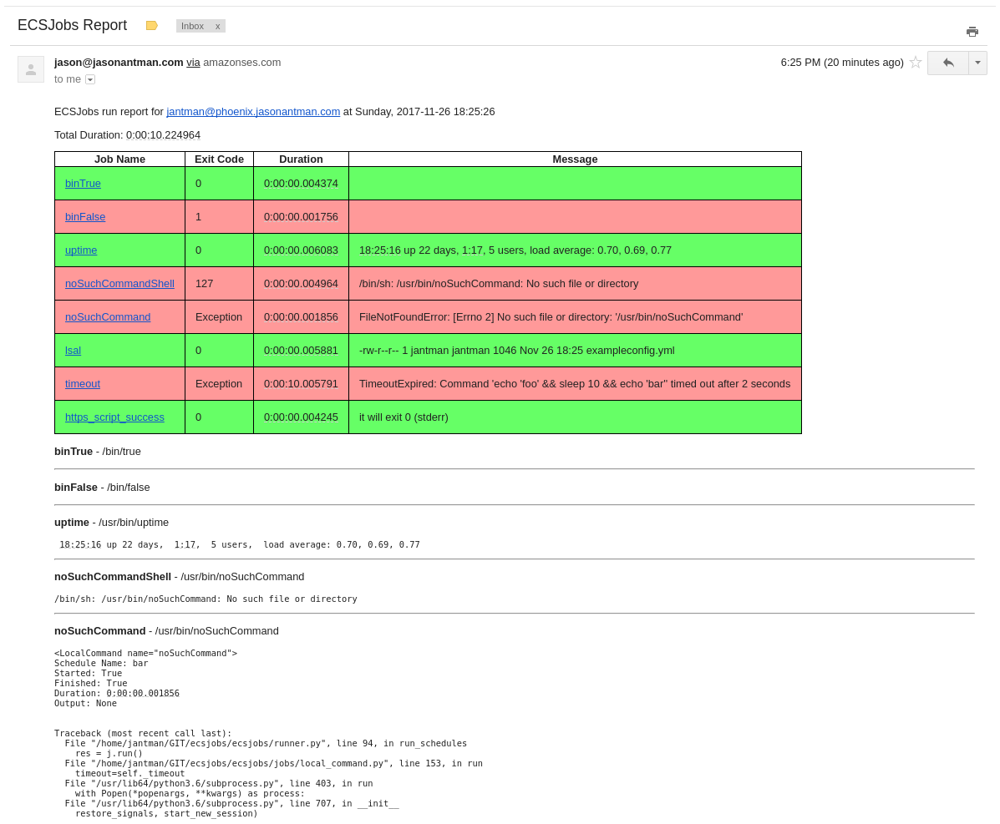

ecsjobs
=======

.. image:: https://www.repostatus.org/badges/latest/active.svg
   :alt: Project Status: Active – The project has reached a stable, usable state and is being actively developed.
   :target: https://www.repostatus.org/#active

.. image:: https://github.com/jantman/ecsjobs/actions/workflows/tests.yml/badge.svg
   :alt: Tests status
   :target: https://github.com/jantman/ecsjobs/actions/workflows/tests.yml

* Documentation: `https://jantman.github.io/ecsjobs/ <https://jantman.github.io/ecsjobs/>`_
* Package: `ecsjobs on PyPI <https://pypi.org/project/ecsjobs/>`_
* Docker image: ``ghcr.io/jantman/ecsjobs`` on the GitHub Container Registry

A scheduled job wrapper for ECS, focused on email reporting and adding docker exec and local command abilities.

This is a very, very esoteric project with a really niche use case.

I've migrated my very small personal AWS infrastructure to a single t2.micro ECS instance. I'm also trying to migrate some of
my personal stuff from my desktop computer to that instance. I need a way to run scheduled tasks and report on their success
or failure, and maybe some output (I have a cron wrapper script that does this on my desktop). But my AWS spend is about $15/month
and I don't want to go over that just because of a bunch of CloudWatch alarms. Also, sometimes the scheduled things I want
to run are really ``docker exec`` into existing task containers.

This is a Python project (distributed as an ECS-ready Docker image) that aims to handle running scheduled things
and then sending an email report on their success or failure. The main shortcomings this intends to address are
the lack of simple built-in failure monitoring for Scheduled ECS Tasks, the lack of a built-in way to execute a
command in a running (ECS Service) container, and the lack of useful email reports.

The generated email reports look like (this one for ``exampleconfig.yml``):

